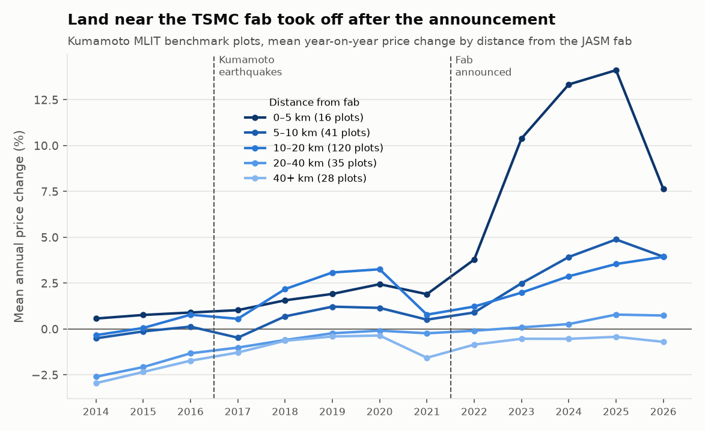
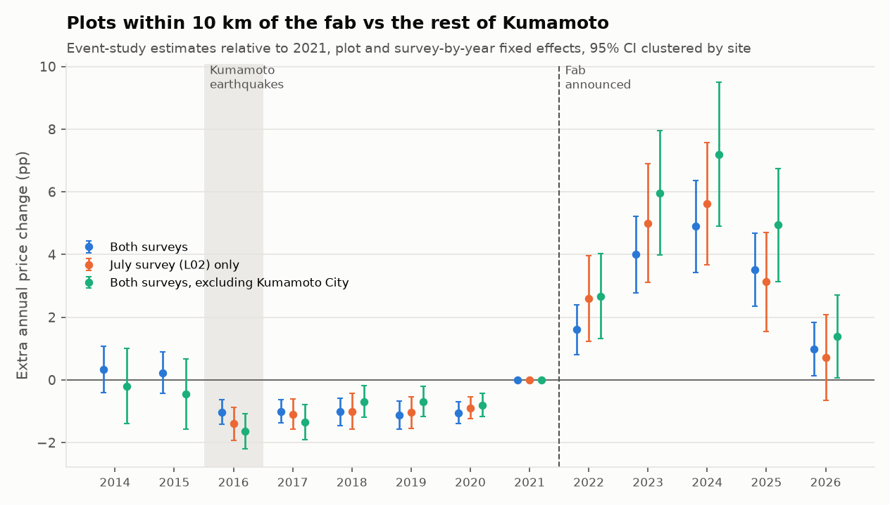
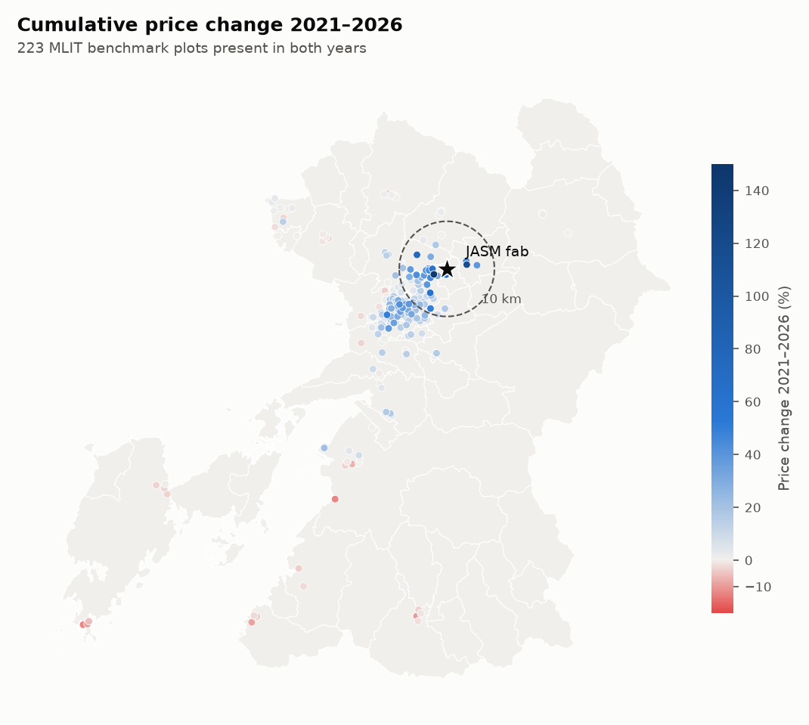
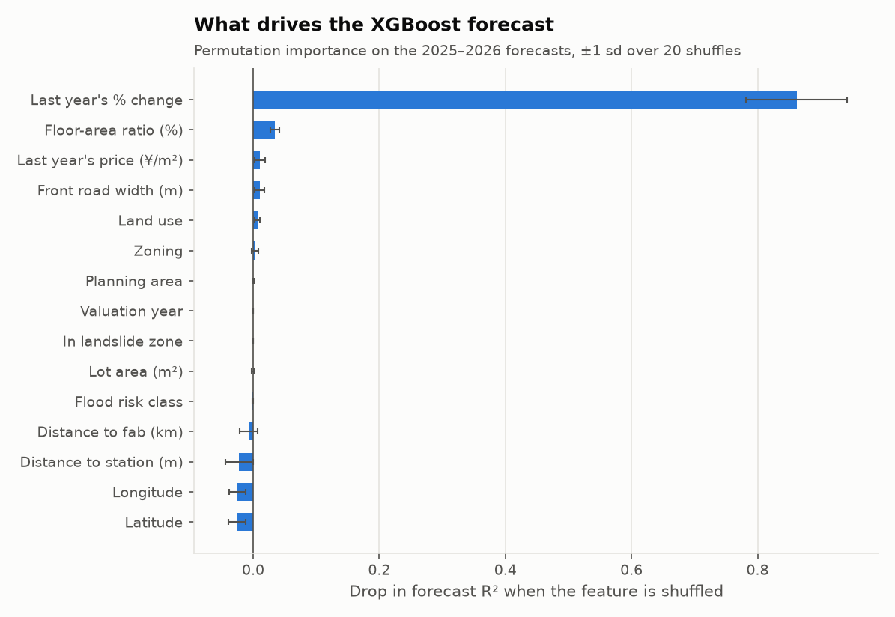

# Did TSMC's Kumamoto fab move land prices?

A geospatial analysis of Japan's two official benchmark land-price surveys around the JASM semiconductor fab that TSMC, Sony and Denso built in Kikuyo, Kumamoto, from 2013 to 2026:

- **Chika-Kouji** (地価公示, MLIT L01): about 250 plots, valued every January 1
- **Prefectural land price survey** (都道府県地価調査, MLIT L02): about 470 plots, valued every July 1 by different appraisers

TSMC confirmed the fab in October 2021, so the 2022 valuation is the first that could reflect it in both surveys.



**Stakeholder summary:** [notebooks/findings.ipynb](notebooks/findings.ipynb) explains the findings in plain terms, including what they mean for planners, landowners and investors, and sets out the work needed to extend the project.

## Findings

**Land near the fab appreciated much faster after the announcement, in both surveys.** Plots within 5 km of the fab rose 10–18% a year at the peak, against roughly zero for plots 20–40 km away. Between the 2021 and 2026 valuations the median site within 10 km gained 18.5%, against 0.5% for the rest of the prefecture.

| Mean annual change | 2021 | 2022 | 2023 | 2024 | 2025 | 2026 |
|---|---|---|---|---|---|---|
| Within 5 km, January survey | 1.9% | 3.8% | **10.4%** | **13.3%** | **14.1%** | 7.6% |
| Within 5 km, July survey | 3.0% | **10.8%** | **16.3%** | **17.7%** | **11.9%** | 7.2% |
| 20–40 km, January survey | −0.2% | −0.1% | 0.1% | 0.3% | 0.8% | 0.7% |
| 20–40 km, July survey | −0.7% | −0.5% | −0.4% | −0.1% | 0.0% | 0.1% |

**The jump is attributable to the announcement, not just a general rise.** A difference-in-differences regression compares each plot with its own history and each valuation with its own survey's prefecture-wide market:

- plot fixed effects and survey-by-year fixed effects
- standard errors clustered by site, so the ~25 sites valued by both surveys count once
- 812 plots (787 sites) and 8,078 plot-years from 2014 to 2026

| Specification | Extra annual price growth near the fab after 2021 | 95% CI |
|---|---|---|
| **Within 10 km, both surveys (main)** | **+3.7 pp** | 2.7 to 4.7 |
| January survey only | +3.0 pp | 1.9 to 4.2 |
| July survey only | +4.3 pp | 2.8 to 5.8 |
| Within 5 km | +8.1 pp | 5.5 to 10.8 |
| Within 15 km | +1.7 pp | 1.1 to 2.3 |
| Pre-period from 2018 (after the earthquake dip) | +3.8 pp | 2.8 to 4.8 |
| Excluding Kumamoto City | +5.2 pp | 3.7 to 6.8 |
| Excluding the 2021 valuation | +3.9 pp | 2.9 to 4.9 |

The two surveys use different plots and different appraisers, and each finds the effect on its own. It holds in every specification (all p < 0.001) and fades with distance. Estimated ring by ring:

| Distance from the fab | Extra growth per year |
|---|---|
| 0–5 km | **+8.7 pp** (6.0 to 11.3) |
| 5–10 km | **+2.4 pp** (1.7 to 3.2) |
| 10–15 km | indistinguishable from zero (+0.3) |
| 15–20 km | small: +0.6 pp (0.2 to 1.0) |
| 20–30 km | indistinguishable from zero (+0.1) |



**What the years before the announcement show.** The event study estimates the near-vs-far gap year by year, relative to 2021:

- **2014–2015:** near and far plots moved together.
- **2016–2020:** near plots ran about 1 pp a year behind. That is the five years after the April 2016 Kumamoto earthquakes, whose epicentre was next to the fab towns. The July survey's 2016 valuation already falls after them, which is why the gap opens a year earlier in the pooled data.
- **2021:** back level.
- **2022 onwards:** near plots pulled ahead, by up to +4.9 pp a year (+7.2 pp outside Kumamoto City).

Because the comparison period includes the depressed post-earthquake years, the estimates are, if anything, conservative. Dropping 2021 gives +3.9 pp.

**The boom is cooling.** The July 2026 prefectural survey is the newest data. Growth within 5 km fell from 17.7% (July 2024) to 11.9% and then 7.2%, and the near-vs-far gap in the July survey (+0.7 pp in 2026) is no longer statistically significant.



## How good is the model, honestly?

The project also trains models to predict each plot's annual price change. The original version reported R² = 0.63 from a random train/test split. That number leaked: each plot appears once a year, so the random split put most test plots' other years into training.

Every candidate is trained on the January survey and scored on the same honest splits, next to three baselines that need no model. Rows are post-announcement valuations (2022–2026) that have a previous-year change: 1,196 January-survey rows, plus 2,122 July-survey rows for the external tests. The external tests leave out sites valued by both surveys.

| R² | Unseen plots | Unseen areas | Forecast 2025–26 | July-survey plots, same years | July-survey plots, forecast 2025–26 | Random rows (leaky, reference only) |
|---|---|---|---|---|---|---|
| Persistence: this year = last year's change | 0.69 | 0.69 | **0.72** | 0.75 | **0.78** | 0.69 |
| Municipality-year mean | 0.45 | −0.09 | n/a | 0.30 | n/a | 0.47 |
| Training mean | 0.00 | −0.07 | −0.13 | −0.10 | −0.02 | 0.00 |
| Random Forest | **0.79** | 0.69 | 0.64 | 0.82 | 0.67 | 0.79 |
| XGBoost | 0.78 | 0.61 | 0.69 | **0.83** | 0.57 | 0.82 |

- **Unseen plots** (5-fold, grouped by plot): Random Forest beats persistence (R² 0.79 vs 0.69, MAE 0.88 vs 0.96 pp). The plot attributes MLIT records (floor-area ratio, land use, road width, last year's price) help explain *which* plots move.
- **July-survey plots, same years:** the January-trained models reach higher R² than persistence (0.82–0.83 vs 0.75), so they make fewer large misses on another survey's plots. Their typical miss is slightly larger, though: MAE 0.79–0.83 vs 0.75 pp. 40% of these rows lie outside any planning area, a category the January survey never contains.
- **Unseen areas** (8 spatial blocks, each held out in turn): the models only tie persistence. Annual changes are strongly spatially correlated (Moran's I between 0.44 and 0.58 in every year, p = 0.001), so a held-out area is genuinely hard.
- **Forecast** (train to 2024, predict 2025 and 2026): **neither model beats persistence in either survey.** 2022–2024 were accelerating years near the fab and growth then slowed sharply, so models trained on the acceleration overshoot. Errors concentrate in Ozu, Kikuyo and Koshi, the towns closest to the fab, and in 2026 they cluster in space (residual Moran's I 0.37). Modelling the deviation from persistence instead of the level did worse (R² 0.46).



On the forecast years, shuffling last year's change drops R² by 0.86. Shuffling distance to the fab changes nothing: once a plot's momentum is known, the fab adds no further information about next year. The fab effect shows up in the data as momentum, which is why the difference-in-differences above, not the forecasting model, is the right tool for measuring it.

## Data and validation

- **Sources** (all published under the Japan Public Data License 1.0):
  - **January survey (L01):** MLIT Chika-Kouji, 2019–2026 releases. The price history in the 2021 release extends its pre-announcement period back to 2013.
  - **July survey (L02):** the prefectural survey, 2015–2026 releases. MLIT publishes no 2014 file, 2015–2017 are shapefiles only, and forest plots are excluded.
  - **NLNI layers:** flood and landslide hazard zones, and administrative boundaries.
- **Plot linkage:** plots are followed across years with MLIT's official plot numbers and the previous-year number each record carries. MLIT renumbers plots and reuses numbers when it replaces a site. Matching on rounded coordinates, as the first version did, silently lost 63 of 1,712 January-survey transitions, many at the 2024 switch from the JGD2000 to the JGD2011 datum.
- **Checked against MLIT's own figures:** both surveys publish each plot's official change rate (January survey from 2022, July survey from 2021). The computed change matches it **exactly** in all 3,950 cases (1,216 + 2,734), using MLIT's rounding. That check also confirms the column mapping for the July survey's four file layouts (`tests/test_mlit_consistency.py`).
- **Sites in both surveys:** about 25 sites are valued in January and July. They are paired by location (within 10 m), checked against MLIT's own common-point flag, and treated as one site in the analysis.
- **Municipality names:** 11 of the 24 municipality codes in the original code were mislabelled, including the fab's host town (43404, Kikuyo). The July survey covers all 49 municipalities, and every code is checked against a reference list (`tests/test_muni_validation.py`).

More detail is in [docs/methods.md](docs/methods.md).

## Limitations

- Benchmark prices are appraisals, not transactions, and appraisers see last year's value. That makes changes smoother and more persistent than market prices.
- There are 39 sites within 5 km of the fab across both surveys, so the estimates closest to the fab still have intervals of about ±3 pp.
- "Near the fab" is defined by straight-line distance. Other investment followed the fab into the same area, such as suppliers, housing and road projects. The estimate is the combined effect of the fab and everything that came with it.

## Running it

```bash
python -m venv .venv
.venv\Scripts\activate          # or: source .venv/bin/activate
pip install -r requirements.txt

python scripts/download_data.py  # fetch the MLIT files into data/raw/
python main.py --all             # run all five stages
pytest                           # consistency checks plus an end-to-end run
streamlit run dashboard.py       # interactive dashboard
python notebooks/build_findings.py  # rebuild the stakeholder notebook
```

| Stage | Module | Output |
|---|---|---|
| 1. Load | `src/load_data.py`, `src/data_sources/` | one row per plot and year for each survey, linked by MLIT plot number; common sites paired |
| 2. Features | `src/features.py` | annual % change, last year's change, distance to the fab, MLIT plot attributes, hazard flags |
| 3. Models | `src/train.py` | `data/analysis/model_comparison.csv`, including the external July-survey tests |
| 4. Forecast errors | `src/evaluate.py` | worst forecasts, permutation importance, residual Moran's I |
| 5. Fab impact | `src/fab_impact.py` | distance bands, difference-in-differences, event studies, figures |
